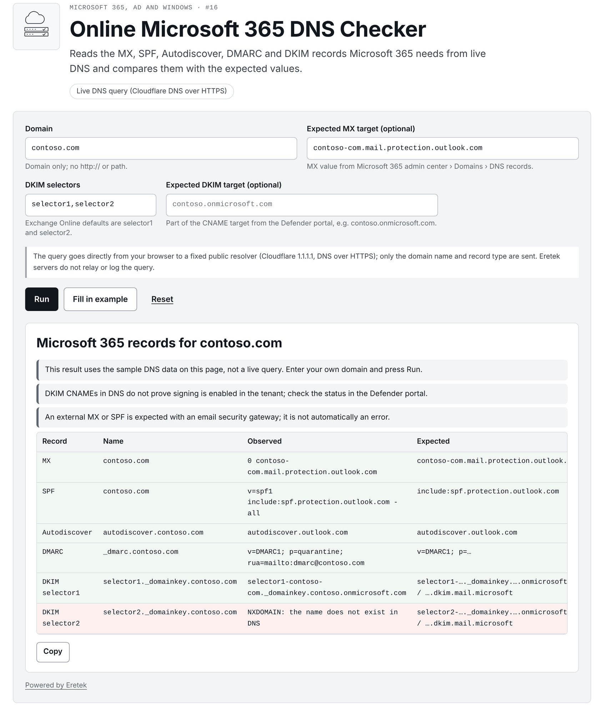

# Microsoft 365 DNS Checker

Check the Microsoft 365 DNS records of your domain: MX, SPF, Autodiscover, DMARC and DKIM selector CNAMEs, with optional comparison to your tenant values.

## Try it live

- [Türkçe](https://sistem.eretek.com/araclar/microsoft-365-dns-kontrolu)
- [English](https://sistem.eretek.com/en/tools/microsoft-365-dns-checker)
- [Deutsch](https://sistem.eretek.com/de/werkzeuge/microsoft-365-dns-pruefung)



## What it does

Reads the MX, SPF, Autodiscover, DMARC and DKIM records Microsoft 365 needs from live DNS and compares them with the expected values.

Most mail problems during and after a Microsoft 365 migration come from DNS: the MX still points to the old server, SPF lacks the Microsoft include, DKIM CNAMEs are missing. The tool reads the records from a public resolver and separates three states: the **observed** value, Microsoft's **expected** pattern, and what **cannot be verified** in the tenant.

The tool does not connect to your tenant. If you enter the exact values shown on the Domains page of the Microsoft 365 admin center, it compares them one to one.

## Where it helps

Fix 'missing' rows first, especially SPF and MX. Compare 'external target' with your architecture: with a filtering service, Exchange Online needs an inbound connector and enhanced filtering.

DKIM CNAMEs in DNS do not prove that signing is enabled in the tenant. Check that the status is 'Signing' under Email authentication › DKIM in the Defender portal.

## How to use it

1. Enter the domain (e.g. `contoso.com`).
2. Optionally enter the MX target from the admin center (`contoso-com.mail.protection.outlook.com`) and part of the DKIM CNAME target.
3. Change the selector list if you use other DKIM selectors, then press Run.

### Fields

| Field | Description |
|---|---|
| Domain | Domain only; no http:// or path. |
| Expected MX target (optional) | MX value from Microsoft 365 admin center › Domains › DNS records. |
| DKIM selectors | Exchange Online defaults are selector1 and selector2. |
| Expected DKIM target (optional) | Part of the CNAME target from the Defender portal, e.g. contoso.onmicrosoft.com. |

## Example input

Press **Fill in example** in the tool to load this input.

| Input | Value |
|---|---|
| Domain | `contoso.com` |
| Expected MX target (optional) | `contoso-com.mail.protection.outlook.com` |
| DKIM selectors | `selector1,selector2` |

**Expected result:** In the sample data MX, SPF, Autodiscover, DMARC and selector1 match; the selector2 CNAME does not exist (NXDOMAIN) and is marked 'missing'.

## Method and assumptions

Queries go from your browser to Cloudflare DNS over HTTPS (1.1.1.1): MX and TXT of the domain, the `autodiscover` CNAME, the `_dmarc` TXT and `selectorN._domainkey` CNAMEs.

Expected patterns follow Microsoft's external DNS records documentation: MX target `*.mail.protection.outlook.com` (newer tenants may use `*.mx.microsoft`), `include:spf.protection.outlook.com` in SPF, Autodiscover CNAME `autodiscover.outlook.com`, DKIM CNAME target `selectorN-…._domainkey.….onmicrosoft.com`.

An MX pointing elsewhere is not automatically an error: with an email security gateway it is expected and shown as 'external target observed'.

## Limits and common mistakes

- Tenant settings (accepted domains, connectors, DKIM status) cannot be read.
- SRV and lyncdiscover records for Teams/Skype and Intune CNAMEs are not checked in this version.
- Because of DNS caching, a recent change may not be visible until the TTL expires.

## Run it locally

The tool is plain HTML, CSS and JavaScript with no build step and no dependencies.

```bash
git clone https://github.com/eretek/microsoft-365-dns-checker.git
cd microsoft-365-dns-checker
node scripts/serve.js        # or: python3 -m http.server 8080
```

Open <http://127.0.0.1:8080/>. Add `?lang=tr` or `?lang=de` for Turkish or German; without it the page follows the browser language and falls back to English. You can also open `index.html` directly from disk.

Run the tests (Node.js 18 or later):

```bash
node test/run.js    # or: npm test
```

The tests run the tool's own fixtures and the worked examples in all three languages without a browser.

## How it works

Everything except the DNS lookup runs in your browser. The lookup goes directly from the browser to a fixed public DNS-over-HTTPS resolver (Cloudflare `cloudflare-dns.com`, with Google `dns.google` as the second resolver in `src/lib/dns.js`); only the domain name and record type are sent. The **Fill in example** button uses sample DNS data stored in `src/data.js`, not a live query.

No server-side component is needed. The version on the Eretek website renders the same page through a private WordPress plugin; that plugin only produces the page markup and is not part of this repository.

| Path | Purpose |
|---|---|
| `index.html` | Page shell |
| `src/app.js` | Builds the page in Turkish, English or German from `src/data.js` |
| `src/data.js` | Field definitions, examples and all texts in three languages |
| `src/core.js` | Shared runtime: validation, number formats, result rendering, CSV/ICS export |
| `src/tool.js` | The calculation or analysis for this tool |
| `docs/screenshot.png` | Screenshot used in this README |
| `src/lib/dns.js` | DNS-over-HTTPS client for fixed public resolvers |
| `src/tools.css`, `src/page.css` | Styles |
| `test/run.js`, `test/cases.json` | Headless tests |

## License and attribution

This tool is released under the [Eretek Website Attribution License](LICENSE). You may use, modify and redistribute it, including commercially. If you make it available on a website or web application, show a visible, clickable credit linking to https://eretek.com/ on every page where the tool is available, for example:

```html
<a href="https://eretek.com/">Powered by Eretek</a>
```

You may add `rel="nofollow"` to the link. Keep the copyright notice and license text in copies and redistributions.
